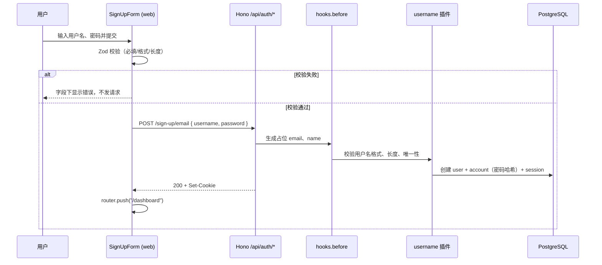

# R01 用户名注册 - 技术设计

> 技术参考：[AGENTS.md](../../AGENTS.md)

## 技术约定

- 认证复用 Better Auth 1.7 + Prisma Adapter；`packages/auth` 定义 `createAuth` 工厂，实例在 `apps/server/src/services.ts` 装配（AGENTS.md「认证与数据库」「服务端与共享接口」）
- Better Auth 插件或 Schema 配置变化后执行 `pnpm run auth:generate`，检查 `auth.prisma` 变化，再走 Prisma 工作流应用数据库变更（AGENTS.md「环境变量与生成代码」）
- 数据模型放 `packages/db/prisma/schema`；Schema 变化后执行 `pnpm run db:generate`（AGENTS.md「开发时的定位与约束」「环境变量与生成代码」）
- Web 路由/页面放 `apps/web/src/app`，跨页面业务组件放 `apps/web/src/components`，基础组件从 `@zyk-admin-ai/ui/components/*` 导入（AGENTS.md「开发时的定位与约束」）
- 表单使用 TanStack Form + Zod 4，提示用 Sonner（AGENTS.md「技术栈与实现位置」）
- Web 客户端为 Better Auth React 客户端 `apps/web/src/lib/auth-client.ts`，baseURL 来自 `NEXT_PUBLIC_SERVER_URL`（AGENTS.md「Web 与 API」「环境变量与生成代码」）
- Hono 入口保持 HTTP 装配职责（AGENTS.md「开发时的定位与约束」）
- 共享包通过 `package.json` exports 暴露 TS 源码，消费方编译（AGENTS.md「服务端与共享接口」）
- 新增输入在服务端验证（AGENTS.md「开发时的定位与约束」）
- 修改 `apps/web` 代码前先阅读 `apps/web/AGENTS.md`，查阅 `node_modules/next/dist/docs/` 对应指南（AGENTS.md「开发时的定位与约束」）
- 代码遵循 Ultracite 规范，提交前 `pnpm run check` 通过（AGENTS.md「Ultracite Code Standards」）
- 新增测试框架时明确职责并更新 AGENTS.md（AGENTS.md「开发时的定位与约束」）

## 方案概述

1. **服务端认证**：在 `createAuth` 中启用 Better Auth `username` 插件：
   - `minUsernameLength: 3`、`maxUsernameLength: 20`、`usernameValidator` 只允许 `^[A-Za-z0-9_]+$`（插件默认还允许 `.`，需收紧）
   - 保持默认 `usernameNormalization`（转小写），`username` 列存小写值并唯一，实现「忽略大小写唯一」；`displayUsername` 保存用户原始输入
   - `emailAndPassword.minPasswordLength` 显式设为 8
2. **只用用户名注册**：Better Auth 注册接口 `POST /api/auth/sign-up/email` 必须有 `email` 和 `name`。在 `createAuth` 中加 `hooks.before`（`createAuthMiddleware`），仅匹配 `/sign-up/email`：
   - 请求体缺少 `username` → 抛 `APIError("BAD_REQUEST")`（本期仅支持用户名注册）
   - 用小写用户名生成占位邮箱 `<username>@users.zyk-admin-ai.invalid`（`.invalid` 为保留顶级域，永不可投递），`name` 设为原始用户名，覆盖客户端传入的 `email`/`name`
   - 用户名格式、长度、唯一性仍由 username 插件校验（插件内部钩子）
   - 已与用户确认
3. **共享校验规则**：在 `packages/auth/src/username.ts` 导出用户名/密码规则常量、Zod schema 和错误文案（只依赖 zod，不引入 better-auth），服务端插件配置和 Web 表单共用，避免两边规则不一致。Web 新增依赖 `@zyk-admin-ai/auth: workspace:*`，只导入 `@zyk-admin-ai/auth/username` 子路径。
4. **Web 客户端**：`auth-client.ts` 加 `usernameClient()` 插件。注册表单改为用户名 + 密码两项，调用 `authClient.signUp.email({ username, password, email: "", name: "" })`（`email`/`name` 由服务端钩子覆盖；类型上必填，传空串）。
5. **表单通用交互**：新增 `apps/web/src/lib/auth-errors.ts`，把 Better Auth 错误码/网络错误映射为中文提示；注册和后续登录表单共用。
6. **测试基建**（技术参考未规定测试框架，以下方案已与用户确认）：
   - `apps/server`：Vitest，测试文件 `src/**/*.test.ts`。为便于测试，把 Hono 应用装配从 `src/index.ts` 拆到 `src/app.ts`（导出 `app`），`index.ts` 只负责 `serve`。测试通过 `app.request()` 调真实认证接口和数据库。脚本 `test: vitest run`（`src/env.server.ts` 已 `import "varlock/auto-load"`，无需 `varlock run` 包装；实现时修正）。
   - `apps/web`：Playwright E2E，目录 `apps/web/e2e/`，`playwright.config.ts` 的 `webServer` 同时启动 server（3000）与 web（3001）。脚本 `test:e2e: playwright test`。
   - 根 `package.json` 增加 `test`、`test:e2e`，`turbo.json` 增加对应任务（不缓存）。
7. **lint 修复**：根 `biome.json` 中 `nursery.useTailwindSortedClasses` 改为当前 Biome 支持的 `nursery.useSortedClasses`（或删除），使 `pnpm run check` 可运行。

## 涉及模块 / 文件

| 文件 | 改动 |
| --- | --- |
| `biome.json` | 修复未知规则键 |
| `packages/auth/src/username.ts` | 新增：用户名/密码规则、Zod schema、错误文案、占位邮箱生成函数 |
| `packages/auth/src/index.ts` | 启用 `username` 插件、`minPasswordLength`、`hooks.before` |
| `packages/db/prisma/schema/auth.prisma` | 由 `auth:generate` 生成：`User` 增加 `username String? @unique`、`displayUsername String?` |
| `packages/db/prisma/migrations/*` | `db:migrate` 生成首个迁移 |
| `apps/server/src/app.ts` | 新增：从 `index.ts` 拆出的 Hono 应用装配 |
| `apps/server/src/index.ts` | 只保留 `serve(app)` |
| `apps/server/src/auth.test.ts` | 新增：注册接口集成测试 |
| `apps/server/vitest.config.ts`、`package.json` | 新增 Vitest 配置与脚本 |
| `apps/web/src/lib/auth-client.ts` | 增加 `usernameClient()` |
| `apps/web/src/lib/auth-errors.ts` | 新增：错误映射 |
| `apps/web/src/components/sign-up-form.tsx` | 改为用户名 + 密码，中文提示，错误映射 |
| `apps/web/src/components/form-text-field.tsx` | 新增（实现时补充）：表单输入框 + 字段错误的复用组件，供注册/登录表单共用 |
| `apps/web/package.json` | 增加 `@zyk-admin-ai/auth`、`@playwright/test` 及 `test:e2e` 脚本 |
| `apps/web/playwright.config.ts`、`apps/web/e2e/sign-up.spec.ts` | 新增 E2E |
| `package.json`、`turbo.json` | 增加 `test`、`test:e2e` 任务 |
| `AGENTS.md` | 记录测试框架、命令和 username 方案 |

## 数据模型

`user` 表新增（由 username 插件定义，经 `auth:generate` 写入 `auth.prisma`）：

| 字段 | 类型 | 说明 |
| --- | --- | --- |
| `username` | `String? @unique` | 小写规范化后的用户名，唯一约束保证忽略大小写唯一 |
| `displayUsername` | `String?` | 用户注册时输入的原始用户名，用于展示 |

`email` 存放占位邮箱 `<小写用户名>@users.zyk-admin-ai.invalid`，`name` 存放原始用户名。密码哈希由 Better Auth 存于 `account.password`（`providerId = "credential"`），不存明文。

## 接口设计

不新增 tRPC 接口，使用 Better Auth 现有接口：

- `POST /api/auth/sign-up/email`
  - 请求：`{ username: string; password: string; email?: string; name?: string }`（`email`/`name` 被服务端钩子覆盖）
  - 成功：200，返回 `{ token, user }`，并 `Set-Cookie` 会话（`autoSignIn` 默认开启）
  - 失败（Better Auth 错误码）：

| 场景 | 状态码 | 错误码 | 前端文案 |
| --- | --- | --- | --- |
| 缺少用户名 | 400 | 自定义 `USERNAME_REQUIRED` | 请输入用户名 |
| 用户名格式不合法 | 400 | `INVALID_USERNAME` | 用户名只能包含英文字母、数字和下划线 |
| 用户名过短/过长 | 400 | `USERNAME_TOO_SHORT` / `USERNAME_TOO_LONG` | 用户名长度为 3～20 个字符 |
| 密码过短 | 400 | `PASSWORD_TOO_SHORT` | 密码至少 8 个字符 |
| 用户名已存在 | 400/422 | `USERNAME_IS_ALREADY_TAKEN`，或占位邮箱冲突时的 `USER_ALREADY_EXISTS*` | 用户名已存在 |
| 网络异常 | — | 无响应 / `fetch` 抛错 | 网络异常，请稍后重试 |
| 其他 | 任意 | 其他 | 注册失败，请稍后重试 |

错误码的具体字符串以 better-auth 1.7.12 源码为准，实现时核对。

## 关键流程

## 异常与边界情况

- 用户名前后空格：前端 Zod 先 `trim()` 再校验；服务端校验不通过即返回格式错误。
- 大小写不同的重复注册：`username` 规范化为小写后命中唯一约束；占位邮箱同样由小写用户名生成，可能先命中邮箱唯一性，因此前端把 `USERNAME_IS_ALREADY_TAKEN` 和 `USER_ALREADY_EXISTS*` 都映射为「用户名已存在」。
- 网络异常：`authClient` 请求在 `try/catch` 中执行，捕获 `fetch` 抛错或无状态码响应，Toast 提示「网络异常，请稍后重试」，表单保持可提交（`isSubmitting` 复位）。
- 重复提交：按钮在 `isSubmitting` 时禁用并显示加载文案；`onSubmit` 返回的 Promise 结束前 TanStack Form 不会再次提交。
- 绕过前端：直接请求注册接口时由插件和钩子校验，非法值返回 400。
- 移动端 `apps/native` 的邮箱注册示例表单不带 `username`，将被钩子拒绝（本期不改移动端，已确认）。

## 风险与取舍

- **引入 Vitest、Playwright（已确认）**：AGENTS.md 未规定测试框架；工作流要求自动化测试，认证与跳转逻辑需要真实 HTTP + 浏览器验证，单元测试不足以覆盖验收标准。
- **占位邮箱（已确认）**：Better Auth 用户模型强制 email 唯一非空；用 `.invalid` 保留域生成，避免与真实邮箱冲突、避免投递。后续若需真实邮箱，可改为让用户补填。
- **`/sign-in/email` 未禁用**：占位邮箱 + 密码登录与用户名登录安全性等价，保留该端点以免影响移动端示例；如需严格只开放用户名登录，可在 R02 中加入 `disabledPaths`。
- **测试库复用开发库（已确认）**：开发与测试共用 `zyk_admin_ai` 库，测试使用随机用户名，不清理数据。
- **拆分 `apps/server/src/index.ts`**：为可测试性把 `app` 与 `serve` 分离，不改变运行时行为。
