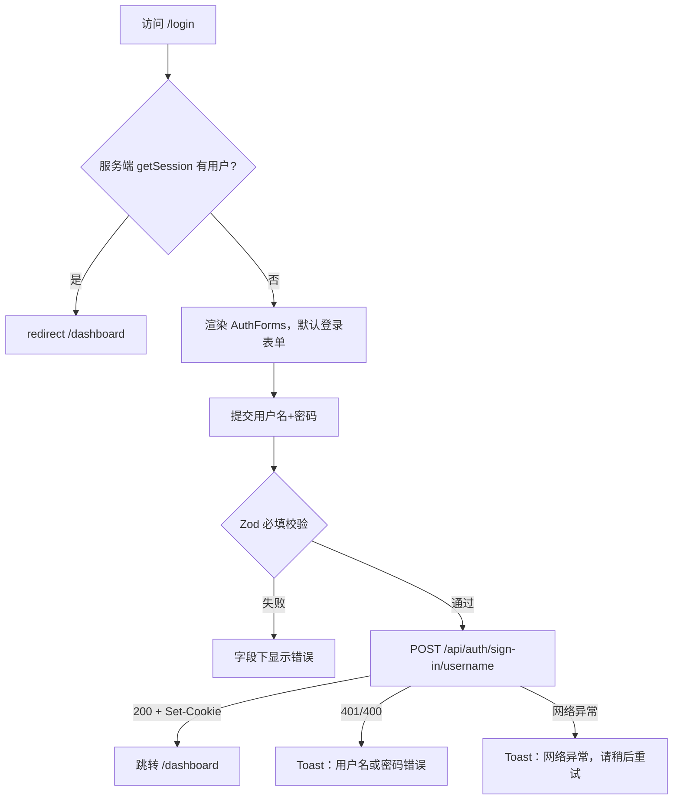

# R02 用户名登录 - 技术设计

> 技术参考：[AGENTS.md](../../AGENTS.md)

## 技术约定

- 认证复用 Better Auth 1.7，Web 使用 Better Auth React 客户端 `apps/web/src/lib/auth-client.ts`（AGENTS.md「认证与数据库」「Web 与 API」）
- Web 路由/页面放 `apps/web/src/app`，页面专属组件就近放置，跨页面业务组件放 `apps/web/src/components`（AGENTS.md「开发时的定位与约束」）
- 服务端页面读取会话的方式与 `/dashboard` 一致：转发请求头调用认证服务获取会话（AGENTS.md「Web 与 API」）
- 表单使用 TanStack Form + Zod 4，提示用 Sonner（AGENTS.md「技术栈与实现位置」）
- Cookie 当前为 `sameSite: "none"`、`secure: true`、`httpOnly: true`，改动登录链路时核对前后端配置（AGENTS.md「认证与数据库」）
- 修改 `apps/web` 代码前阅读 `apps/web/AGENTS.md` 及 `node_modules/next/dist/docs/` 对应指南（AGENTS.md「开发时的定位与约束」）
- 代码遵循 Ultracite 规范（AGENTS.md「Ultracite Code Standards」）
- 测试使用 R01 引入的 Vitest（server）与 Playwright（web）（R01 design.md「方案概述」第 6 条）

## 方案概述

1. **登录表单**：`apps/web/src/components/sign-in-form.tsx` 改为用户名 + 密码两项，复用 R01 的共享 Zod schema（登录只校验必填，不校验格式，避免泄露规则差异；格式不合法的用户名同样得到「用户名或密码错误」），调用 `authClient.signIn.username({ username, password })`。成功后 `router.push("/dashboard")` 并 `router.refresh()`。
2. **统一错误提示**：在 R01 的 `auth-errors.ts` 中增加登录场景映射：`INVALID_USERNAME_OR_PASSWORD`、`INVALID_USERNAME`、`USERNAME_TOO_SHORT/LONG` 等凭据类错误统一为「用户名或密码错误」；网络异常为「网络异常，请稍后重试」；其他为「登录失败，请稍后重试」。
3. **大小写不敏感**：username 插件在登录时同样执行小写规范化后查询，无需额外处理；以测试覆盖。
4. **已登录访问 `/login` 跳转**：把 `apps/web/src/app/login/page.tsx` 改为服务端组件，按 `/dashboard` 的方式用 `authClient.getSession({ fetchOptions: { headers: await headers() } })` 读取会话，有用户则 `redirect("/dashboard")`；否则渲染新的客户端组件 `apps/web/src/app/login/auth-forms.tsx`（原登录/注册切换逻辑，默认显示登录表单）。
5. **刷新保持**：Better Auth 会话 Cookie（默认 7 天有效）由浏览器保存，`/dashboard` 服务端读取会话，刷新天然保持；以 E2E 覆盖。
6. **表单 Loader**：现有表单在 `useSession().isPending` 时整体显示 Loader；改为服务端判定登录态后，表单内不再依赖 `useSession`，避免闪烁。

## 涉及模块 / 文件

| 文件 | 改动 |
| --- | --- |
| `apps/web/src/components/sign-in-form.tsx` | 改为用户名 + 密码，中文提示，错误映射，加载禁用 |
| `apps/web/src/components/sign-up-form.tsx` | 去掉 `useSession` Loader（与登录表单保持一致） |
| `apps/web/src/lib/auth-errors.ts` | 增加登录错误映射 |
| `apps/web/src/app/login/page.tsx` | 改为服务端组件，已登录跳转 `/dashboard` |
| `apps/web/src/app/login/auth-forms.tsx` | 新增：登录/注册切换的客户端组件，默认登录 |
| `apps/server/src/auth.test.ts` | 增加用户名登录接口测试 |
| `apps/web/e2e/sign-in.spec.ts` | 新增登录 E2E |

## 数据模型

无（沿用 R01 的 `user.username` 等字段）。

## 接口设计

使用 Better Auth username 插件接口，不新增接口：

- `POST /api/auth/sign-in/username`
  - 请求：`{ username: string; password: string }`
  - 成功：200，返回 `{ token, user }` 并 `Set-Cookie` 会话
  - 失败：

| 场景 | 状态码 | 错误码 | 前端文案 |
| --- | --- | --- | --- |
| 用户名不存在 / 密码错误 | 401 | `INVALID_USERNAME_OR_PASSWORD` | 用户名或密码错误 |
| 用户名格式/长度不合法 | 400/422 | `INVALID_USERNAME` 等 | 用户名或密码错误 |
| 网络异常 | — | 无响应 | 网络异常，请稍后重试 |
| 其他 | 任意 | 其他 | 登录失败，请稍后重试 |

错误码字符串以 better-auth 1.7.12 源码为准，实现时核对。

## 关键流程

## 异常与边界情况

- 用户名前后空格：前端 `trim()` 后提交。
- 不存在的用户名与错误密码返回同一提示，避免账号枚举；Better Auth 对不存在用户仍做哈希运算以减小时间差。
- 服务端获取会话失败（认证服务不可达）时，`/login` 页按未登录处理并渲染表单，不抛 500；`getSession` 不使用 `throw: true`。
- 登录成功后若 `router.push` 前会话 Cookie 尚未写入：Better Auth 在响应里同步 `Set-Cookie`，跳转时已带上 Cookie。
- 重复提交与网络异常处理同 R01。
- 水合前提交（实现后补充）：表单由服务端直接渲染，水合前点击会触发浏览器原生 GET 提交并把密码写进 URL；用 `useHydrated()` 在水合前禁用提交按钮（禁用的提交按钮同时阻止回车隐式提交）。

## 风险与取舍

- **保留 `/sign-in/email`（已确认）**：用户确认保留。若以后需要禁用，在 `createAuth` 中加入 `disabledPaths: ["/sign-in/email"]`，并同步说明移动端示例受影响。
- **`/login` 改为服务端组件**：增加一次服务端到认证服务的请求，换取已登录用户无闪烁跳转；与 `/dashboard` 现有做法一致，不引入 `proxy.ts`。
