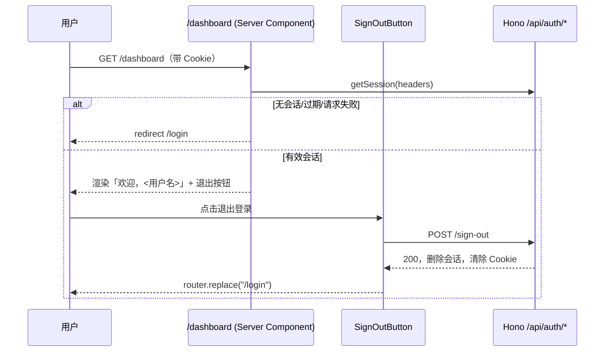

# R03 登录后首页、退出与访问控制 - 技术设计

> 技术参考：[AGENTS.md](../../AGENTS.md)

## 技术约定

- `/dashboard` 服务端页面转发请求头调用认证服务获取会话，缺少用户时跳转 `/login`（AGENTS.md「Web 与 API」）
- 受保护接口复用 `packages/api` 的 `protectedProcedure`，未登录返回 `UNAUTHORIZED`；新增/修改接口在 `packages/api/src/routers` 中注册到 `appRouter`（AGENTS.md「服务端与共享接口」「开发时的定位与约束」）
- 服务端 `apps/server/src/context.ts` 用请求头调用 `auth.api.getSession()` 注入会话（AGENTS.md「服务端与共享接口」）
- 页面专属组件就近放置在 `apps/web/src/app/dashboard/`，跨页面业务组件在 `apps/web/src/components`（AGENTS.md「开发时的定位与约束」）
- Web tRPC 客户端为 `apps/web/src/utils/trpc.ts`，浏览器请求 `credentials: "include"`（AGENTS.md「Web 与 API」）
- 修改 `apps/web` 代码前阅读 `apps/web/AGENTS.md` 及 `node_modules/next/dist/docs/` 对应指南（AGENTS.md「开发时的定位与约束」）
- 代码遵循 Ultracite 规范（AGENTS.md「Ultracite Code Standards」）
- 测试使用 R01 引入的 Vitest（server）与 Playwright（web）（R01 design.md「方案概述」第 6 条）

## 方案概述

1. **首页显示用户名**：`apps/web/src/app/dashboard/page.tsx` 继续在服务端获取会话；展示 `session.user.displayUsername ?? session.user.username`（类型由 R01 的 `usernameClient()` 推断）。去掉模板中的 `Welcome {name}` 与 `API: ...` 示例文本，改为中文「欢迎，<用户名>」。
2. **会话获取异常**：`getSession` 不再使用 `throw: true`；请求失败或无用户都 `redirect("/login")`，避免过期/异常会话导致 500。
3. **退出登录**：新增 `apps/web/src/app/dashboard/sign-out-button.tsx`（客户端组件），调用 `authClient.signOut()`；成功后 `router.replace("/login")` + `router.refresh()`；失败按 R01 `auth-errors.ts` 的网络异常提示；进行中禁用按钮。
4. **Header 用户菜单**：`apps/web/src/components/user-menu.tsx` 显示用户名（不显示占位邮箱），退出后跳转 `/login`（原为 `/`），复用与退出按钮相同的退出逻辑（抽为 `apps/web/src/lib/sign-out.ts` 的 `useSignOut` hook）。
5. **受保护接口**：`privateData` 保留 `protectedProcedure`，返回值改为 `{ username }`（不再返回整个 user 对象，避免暴露占位邮箱等字段）。`dashboard.tsx` 客户端组件可删除；首页不再依赖该接口展示内容，接口由服务端测试覆盖。
6. **会话过期**：Better Auth `getSession` 对 `expiresAt` 已过期的会话返回 `null`（未开启 cookieCache），因此页面和 tRPC Context 自动按未登录处理；以测试覆盖（测试中直接把 `session.expiresAt` 改为过去时间）。

## 涉及模块 / 文件

| 文件 | 改动 |
| --- | --- |
| `apps/web/src/app/dashboard/page.tsx` | 显示用户名、退出按钮，异常时跳转 `/login` |
| `apps/web/src/app/dashboard/sign-out-button.tsx` | 新增：退出按钮 |
| `apps/web/src/app/dashboard/dashboard.tsx` | 删除（模板示例） |
| `apps/web/src/lib/sign-out.ts` | 新增：`useSignOut` hook（退出、跳转、错误提示、进行中状态） |
| `apps/web/src/components/user-menu.tsx` | 显示用户名、退出跳转 `/login`、复用 `useSignOut` |
| `packages/api/src/routers/index.ts` | `privateData` 返回 `{ username }` |
| `apps/server/src/access.test.ts` | 新增：受保护接口与会话过期测试 |
| `apps/web/e2e/dashboard.spec.ts` | 新增：首页、退出、访问控制 E2E |

## 数据模型

无（读取 R01 的 `user.username`、`user.displayUsername`；测试中修改 `session.expiresAt`）。

## 接口设计

- tRPC `privateData`（`protectedProcedure`，query）
  - 有效会话：返回 `{ username: string }`（`displayUsername ?? username`）
  - 无会话 / 会话过期 / 已退出：`TRPCError({ code: "UNAUTHORIZED" })`，HTTP 401
- Better Auth `POST /api/auth/sign-out`：删除数据库中的会话记录并清除 Cookie

## 关键流程

## 异常与边界情况

- 旧 Cookie 重放：退出时服务端删除 `session` 记录，持有旧 Cookie 的请求 `getSession` 返回 `null`，tRPC 返回 `UNAUTHORIZED`。
- 会话过期：`expiresAt < now` 时 Better Auth 不返回会话；页面跳转 `/login`，接口返回 `UNAUTHORIZED`。
- 退出失败：保留当前页面和登录状态，提示错误，可重试。
- 浏览器后退：退出后后退到 `/dashboard` 时，`router.refresh()` 与服务端动态渲染保证重新校验会话；如出现 bfcache 显示旧页面，以服务端校验为准，任何操作都会再次跳转。
- `displayUsername` 为空（R01 前创建的旧账号）：回退显示 `username`，再回退 `name`。

## 风险与取舍

- **`privateData` 返回值变更**：移动端 `apps/native` 若引用 `privateData.user` 需同步修改；实现时检索引用，移动端仅做类型兼容修改，不改界面。
- **删除 `dashboard.tsx`**：它是脚手架示例，删除后首页不再在客户端请求受保护接口；受保护接口的行为由服务端测试覆盖。
